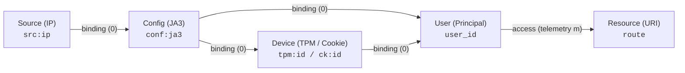
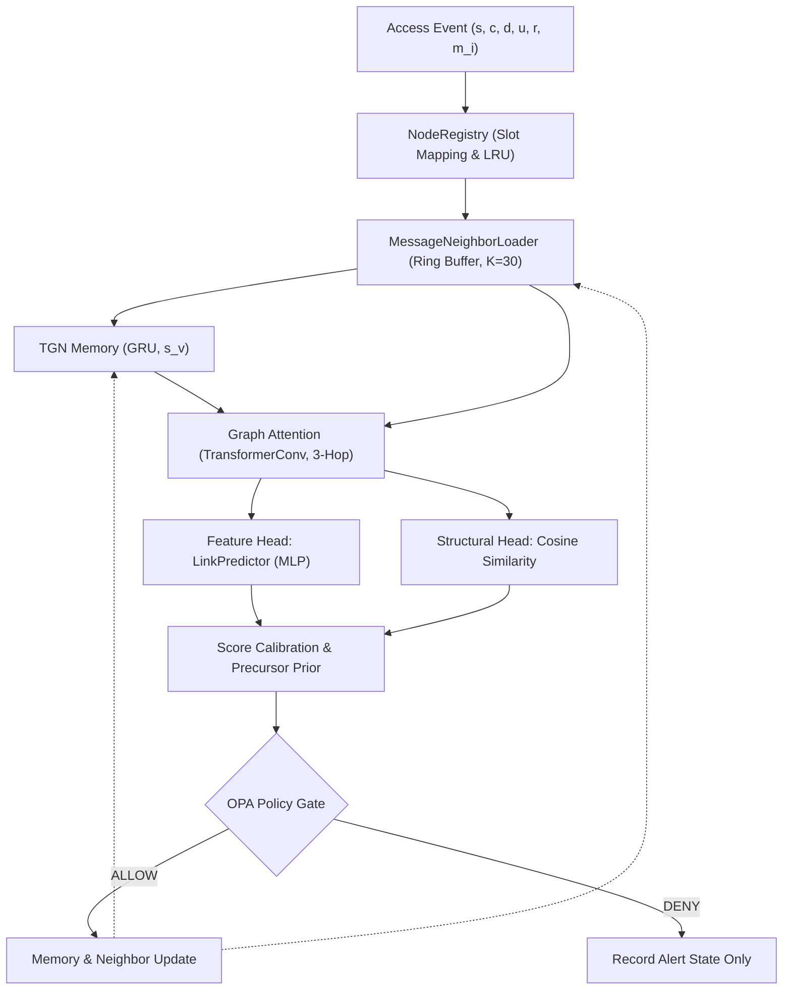
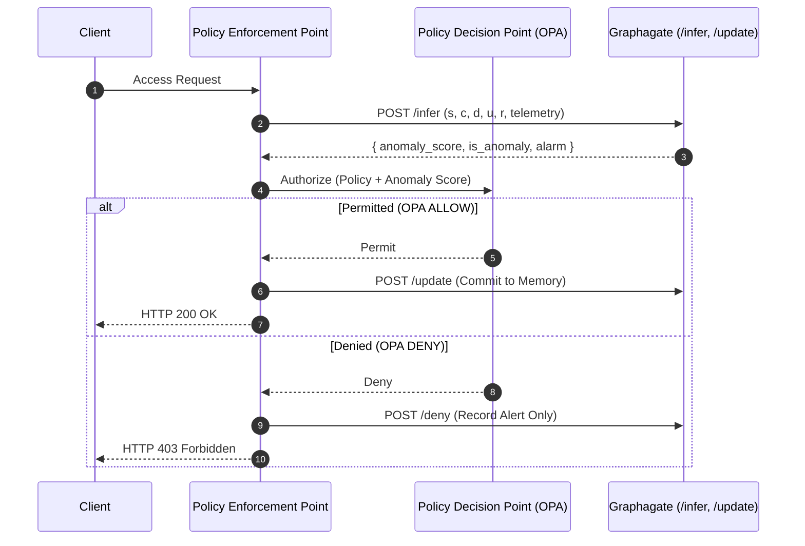

# Graphagate


Graphagate is a streaming Temporal Graph Network (TGN) for anomaly detection in Zero Trust Architectures (ZTA). It analyzes continuous authentication and authorization request streams to detect policy violations, contextual anomalies, lateral movement, and credential abuse without requiring an external graph database.

---

## Architecture Overview

Graphagate models access requests as dynamic edges over a heterogeneous graph. Each access event $e_i = (t_i, s_i, c_i, d_i, u_i, r_i, \mathbf{m}_i)$ is unrolled into a causal 5-edge chain spanning five typed entity nodes:

| Entity Type | Key Format | Semantics | Static Attributes ($\mathbf{f}_v \in \mathbb{R}^{16}$) |
|---|---|---|---|
| **Source** ($s$) | `src:<ip>` | Client network IP (RFC1918 internal / external) | Network locality flag |
| **Config** ($c$) | `conf:<ja3>` | Client TLS profile (`conf:guest` fallback) | Software client profile |
| **Device** ($d$) | `tpm:<id>` / `ck:<id>` | TPM hardware attestation or device cookie | Hardware posture tier (0–2) |
| **User** ($u$) | `usr:<principal>` | Authenticated identity / principal claim | Role & clearance claims |
| **Resource** ($r$) | `res:<route>` | Target asset / route URI | Sensitivity & risk classification |



The access edge ($u \to r$) carries dynamic request telemetry $\mathbf{m}_i \in \mathbb{R}^7$ (TLS validity flag, IDS probes $s_1\text{--}s_3$, HTTP method, normalized role, and clearance). The four structural binding edges carry zero-vectors $\mathbf{0}$, capturing relational pattern breaks (such as novel credential-device combinations or tool shifts).

---

## Model Components & Pipeline



1. **Hashed Identity (`hash_emb`)**: Open-world entity keys are mapped via deterministic BLAKE2b hashing into embedding buckets, producing inductive identity representations $\mathbf{h}_v \in \mathbb{R}^{16}$ for entities unseen during training.
2. **Recurrent Node Memory (`memory`)**: A GRU-based memory module updates continuous-time state $\mathbf{s}_v \in \mathbb{R}^{256}$ from interaction messages.
3. **Bounded Neighbor Store (`neighbor_loader`)**: Fixed-size in-RAM ring buffers store the last $K=30$ temporal interactions per node, enabling message passing over recent history without graph database lookups.
4. **Temporal Attention Encoder (`gnn`)**: A 3-hop `TransformerConv` encoder with residual connections embeds historical interaction features and harmonic relative time encodings $\phi(\Delta t) \in \mathbb{R}^{32}$.
5. **Dual Scoring Heads**:
   - **Feature Head (`link_pred`)**: A residual MLP evaluating node representations, edge telemetry, static features, and causal interaction counters $\mathbf{c}_{vw} = [\log(1+n_{vw}), \log(1+n_v), \frac{n_{vw}}{n_v+1}]$ to detect policy and contextual anomalies.
   - **Structural Head (`struct_proj`)**: Computes scaled cosine compatibility $\gamma \langle \hat{\mathbf{z}}_s, \hat{\mathbf{z}}_d \rangle$ between projected node representations, detecting unhabitual topological pairings (lateral pivots).
6. **Tail Calibration & Precursor Prior**: Edge anomaly logits are calibrated against empirical validation quantiles, boosted by an exponential kill-chain prior for entities with recent alerts ($t_{1/2} = 72\text{h}$), and evaluated against operational operating thresholds.
7. **Predict-Then-Update Gate**: Memory updates occur strictly after external policy evaluation (`OPA ALLOW`). Denied requests record alert state without polluting temporal memory or neighbor history.

---

## Training Protocol

The model trains under a one-class / semi-supervised regime using policy-compliant benign traffic ($y=0$):

- **Loss Formulation**:
  $$\mathcal{L} = \mathcal{L}_{\mathrm{NCE}}^{\mathrm{access}} + \mathcal{L}_{\mathrm{pos}}^{\mathrm{access}} + \mathcal{L}_{\mathrm{ctx}} + \sum_{(v, w) \in E^{\mathrm{bind}}} \left(\mathcal{L}_{\mathrm{NCE}}^{(v,w)} + \mathcal{L}_{\mathrm{pos}}^{(v,w)}\right)$$
  - **InfoNCE Ranking**: Ranks the true destination against $K=5$ negative destinations (75% uniform random, 25% active batch destinations).
  - **Positive BCE Anchoring**: Prevents logit drift, anchoring nominal benign scores for quantile calibration.
  - **Contextual Regularization**: Applies Gaussian perturbations to access telemetry to penalize off-nominal attributes.
- **Two-Stage Schedule**:
  - **Stage 1**: End-to-end training across memory, attention backbone, and scoring heads using AdamW with cosine annealing.
  - **Stage 2**: Memory and attention layers are frozen; the link predictor MLP is fine-tuned at reduced learning rate ($\mathrm{lr} = 10^{-4}$).

---

## Limitations and Threat Model

- **External Validity**: Published benchmark numbers are evaluated primarily on continuous synthetic streams. Public enterprise datasets containing simultaneously verified user identities, TLS fingerprints, and labeled lateral movement are scarce. PicoDomain provides real fields across all five nodes but covers a small environment (6 hosts, 2.67 days); LANL auth lacks TLS/config telemetry.
- **Policy Gate Coupling (Poisoning vs. Starvation)**: Memory updates commit only on policy-admitted events (`OPA ALLOW`). A stealthy attack that evades policy rules can poison the historical baseline, while legitimate requests rejected by policy cannot update entity habituality (starvation).
- **Precursor Prior**: The kill-chain prior boosts scores based on preceding reconnaissance alerts. An adversary executing lateral movement without prior detectable reconnaissance does not trigger this prior.
- **Cold Start**: Newly observed entities lack interaction history; their anomaly scores initially reflect higher uncertainty until interaction baselines accumulate.
- **Unauthenticated Internal Endpoints**: The microservice endpoints (`/infer`, `/update`, `/deny`) do not implement authentication internally and are designed to be deployed on an isolated network accessible only by trusted Policy Enforcement Points.

---

## Quickstart & Execution

### Docker Compose Profiles

```bash
# 1. Train the streaming model and save checkpoints to public/
docker compose --profile training-tgn up

# 2. Run train/replay verification harness
docker compose --profile verify-tgn up

# 3. Start the HTTP inference service (Host 8888 -> Container 8088)
docker compose --profile serve-tgn up
```

### Standalone Python Execution

```bash
# Install package dependencies
uv pip install -e .

# Run training
python -m graphagate.train_tgn

# Run verification harness
python -m graphagate.verify_tgn

# Start FastAPI serving API
python -m graphagate.serve_api
```

---

## REST API & Orchestrator Integration

The inference microservice (`src/serve_api.py`) runs on FastAPI at port `8088` (mapped to host `8888`):

| Endpoint | Method | Role | Mutates State |
|---|---|---|---|
| `/health` | `GET` | Service readiness probe (returns 503 while loading, 200 when ready) | No |
| `/infer` | `POST` | Scores access request tuple; admits keys into registry | Registry admission only |
| `/update` | `POST` | Commits policy-admitted request (`OPA ALLOW`) to memory and neighbor buffers | Yes |
| `/deny` | `POST` | Records alert triggers for policy-denied requests (`OPA DENY`) | Alert state only |
| `/score` | `POST` | Combined scoring with conditional self-update (testing / standalone mode) | Yes (if benign) |
| `/persist` | `POST` | Serializes current in-RAM state and registry to `public/` | Disk write |

### Integration Flow



Detailed integration examples (Go client implementation, OPA Rego policies, environment settings) are available in [`docs/development/orchestrator_integration.md`](docs/development/orchestrator_integration.md).

---

## Project Layout

```text
docker/
└── Dockerfile               # CUDA-enabled container specification
docs/
├── development/             # Orchestrator integration and architectural notes
├── opa-policies/            # Reference OPA Rego policy definitions
└── references/              # External dataset evaluation runbooks
gui/                         # Browser-based 3D graph visualizer
public/                      # Training checkpoints (checkpoint.pt, stats.json)
scripts/                     # Dataset retrieval and extraction utilities
src/
├── config.py                # Hyperparameters, dimensions, and path configuration
├── calibration.py           # Threshold calibration & empirical tail routing
├── eval_common.py           # Shared evaluation metrics & history features
├── netclass.py              # Network locality classification & guest mapping
├── report_metrics.py        # Statistical comparisons & table generation
├── serve_api.py             # FastAPI REST microservice
├── serve_tgn.py             # Serving primitives, memory updates, and persistence
├── train_tgn.py             # Self-supervised training & calibration pipeline
├── verify_tgn.py            # Stream replay parity & verification test harness
├── data/
│   ├── access_policy.py     # Bell-LaPadula authorization reference model
│   ├── lookup_rules.py      # Stateful binding lookup rules
│   └── stream_synthetic.py  # ZTA stream simulator (policy, lateral, theft)
└── model/
    ├── gnn.py               # GraphAttentionEmbedding (TransformerConv encoder)
    ├── heads.py             # LinkPredictor & StructuralProjector scoring heads
    ├── neighbor.py          # MessageNeighborLoader (bounded ring buffer)
    ├── registry.py          # NodeRegistry (dynamic admission & LRU slots)
    └── tgn.py               # ZTATemporalGraphNetwork model definition
tests/                       # Evaluation suites, ablations, baselines & parity tests
```

---

## License

This project is licensed under the MIT License — see the [LICENSE](LICENSE) file for details.
